  

  
  
  

Projects are on the way. Until then, you can explore everything I am building in my [repositories](https://github.com/anshusingh-56?tab=repositories).

<!--
Add your best projects here like this:

| Project | What it does | Tech |
|---|---|---|
| [Project Name](https://github.com/anshusingh-56/repo) | One line description | C++ |
-->

  
  
   
  
   
  

<picture>
  <source media="(prefers-color-scheme: dark)" srcset="https://raw.githubusercontent.com/anshusingh-56/anshusingh-56/output/github-contribution-grid-snake-dark.svg?v=3">
  
</picture>

